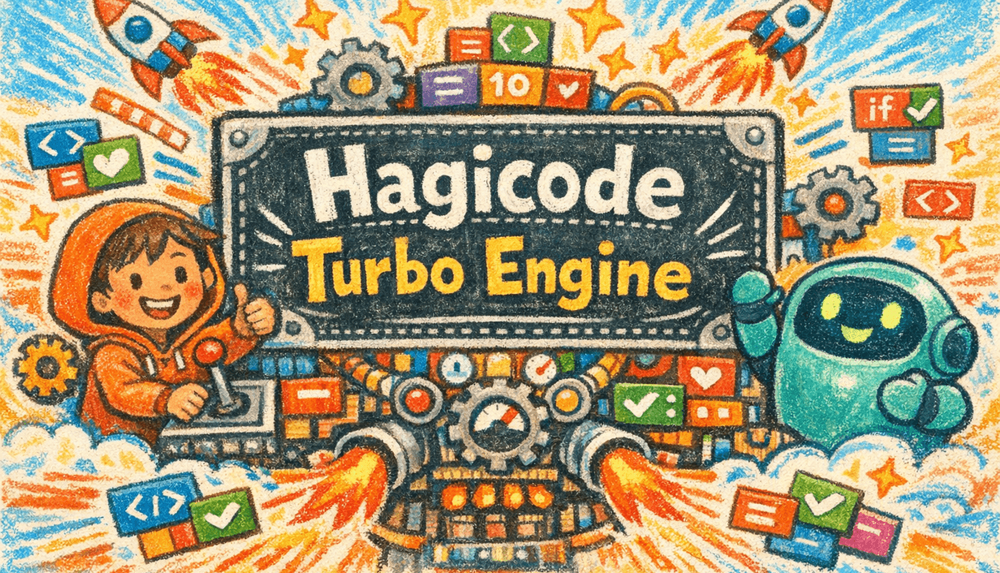
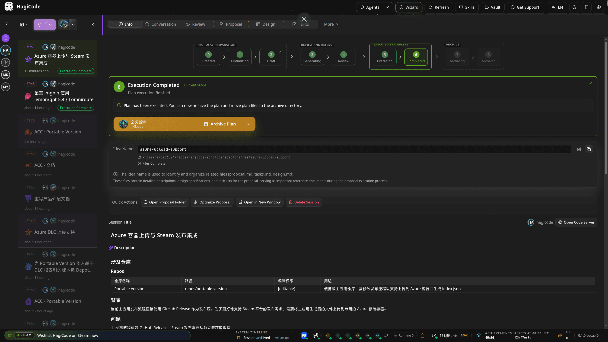
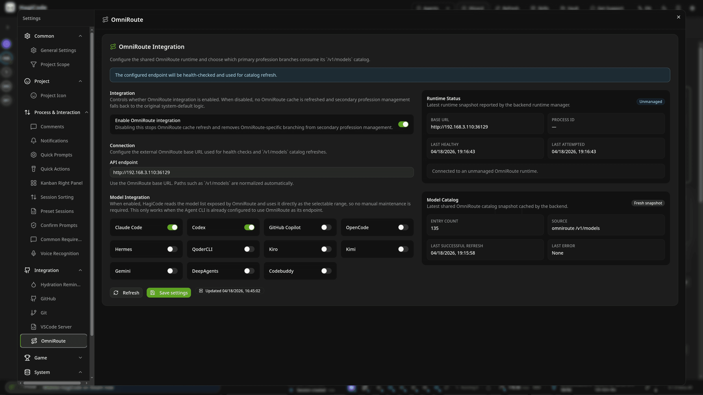
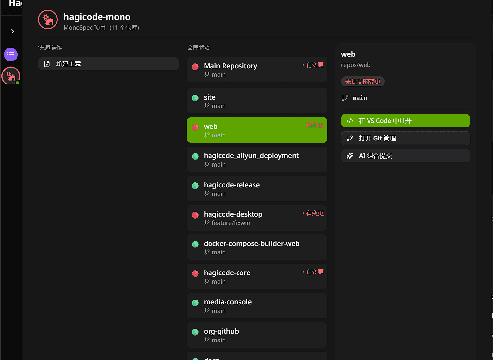
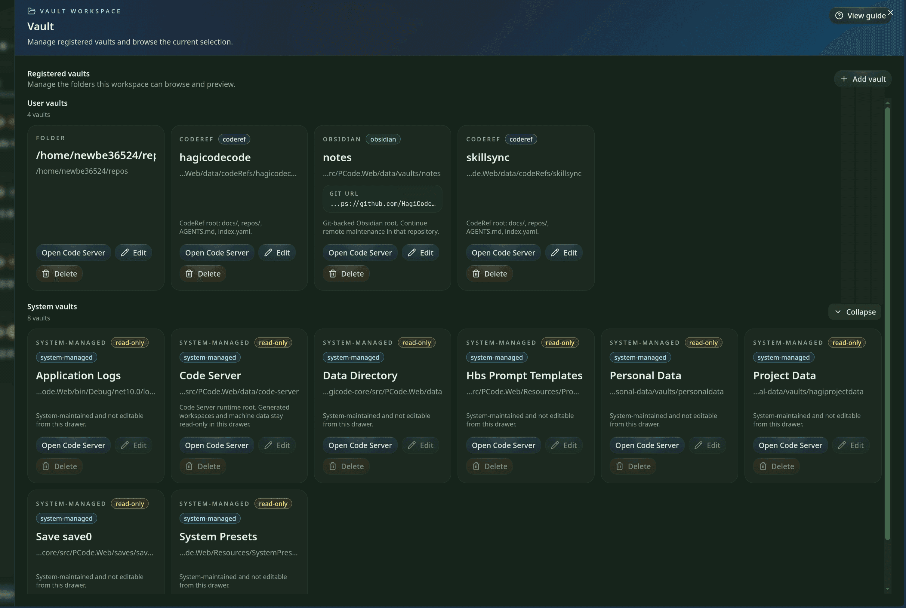
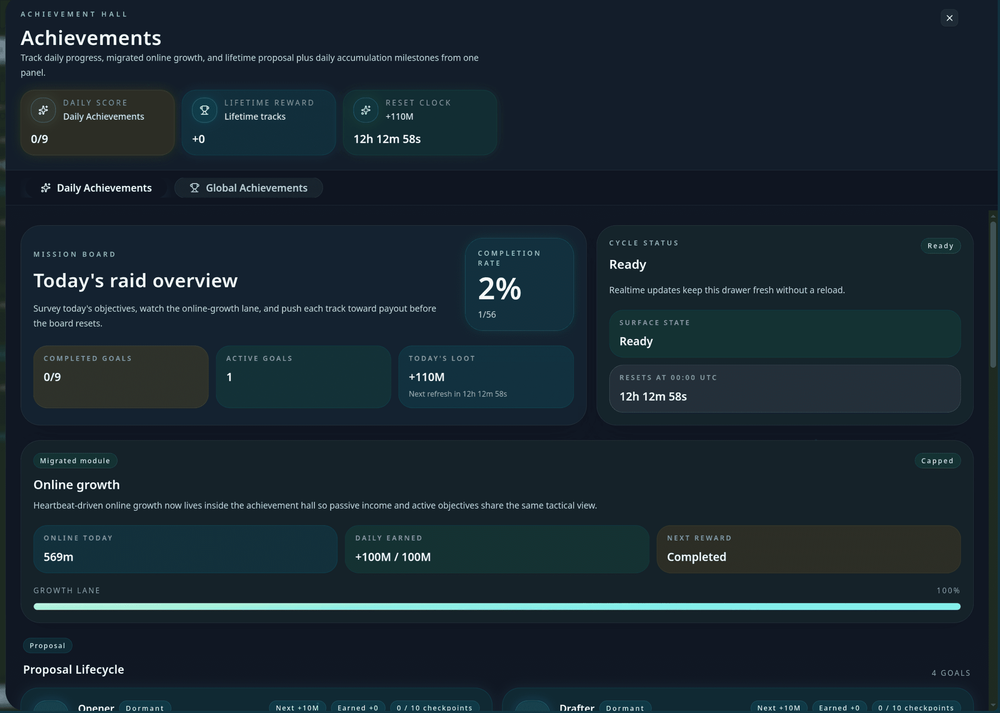

# HagiCode

<strong>HagiCode 是一个把 AI 编程工具、游戏化反馈系统和综合型开发工作台合并在一起的产品。</strong>

你可以用它理解仓库、写提案、拆任务、修改代码、整理提交、管理多仓库，并在同一个工作台里持续沉淀可复用的知识。

<strong>在 Windows 上，请从 Microsoft Store 获取 HagiCode：在那里安装并订阅，即可始终使用最新版本。</strong>

<a href="https://www.hagicode.com/">Website</a>
·
<a href="https://docs.hagicode.com/product-overview/">Product Overview</a>
·
<a href="https://www.hagicode.com/desktop/">Desktop</a>
·
<a href="https://apps.microsoft.com/detail/9N3PM0N3SVDW">Microsoft Store</a>
·
<a href="https://docs.hagicode.com/blog/">Blog</a>

[English](./README.md) · [简体中文](./README_cn.md) · [繁體中文](./README_zh-Hant.md) · [日本語](./README_ja-JP.md) · [한국어](./README_ko-KR.md) · [Deutsch](./README_de-DE.md) · [Français](./README_fr-FR.md) · [Español](./README_es-ES.md) · [Português (Brasil)](./README_pt-BR.md) · [Русский](./README_ru-RU.md)

---

## Microsoft Store And Add-ons

HagiCode for Windows 已上架 Microsoft Store，这是在 Windows 上入门的推荐方式。在 Store 中安装并订阅即可保持最新版本，下载和产品详情请访问官方网站 [hagicode.com](https://www.hagicode.com/)。

TurboEngine 是 Microsoft Store 中销售的一次性永久授权，可解锁 Desktop 安装版不包含的能力：并发提案数从 3 提升到 32，以及文档主题、自定义提交签名、品牌定制和自定义头像上传。

| 预览 | 产品 | 定位 | 入口 |
| --- | --- | --- | --- |
|  | **HagiCode for Windows** | Windows 上桌面应用的推荐入口：安装并订阅即可保持最新版本。Steam 主应用入口已下线。 | [Open Microsoft Store](https://apps.microsoft.com/detail/9N3PM0N3SVDW) · [Desktop downloads](https://www.hagicode.com/desktop/) · [Steam status FAQ](https://docs.hagicode.com/faq/steam-distribution-status/) |
|  | **Hagicode Plus** | Bundle and upgrade guidance remains available through the docs site. | [Read Hagicode Plus docs](https://docs.hagicode.com/bundles/hagicode-plus/) |
|  | **Turbo Engine DLC** | DLC guidance for higher concurrency and customization remains available through the docs site. | [Read Turbo Engine DLC docs](https://docs.hagicode.com/dlc/turbo-engine-dlc/) |

## HagiCode 是什么

HagiCode 不是另一个代码聊天框。它把 AI 带进完整的软件开发流程：理解仓库、规划变更、实现代码、整理提交、追踪知识，并让从想法到归档的全过程都保持可审阅。

## 核心能力

### 1. 用 OpenSpec 驱动提案式 AI 编码

对于非简单工作，HagiCode 会先从提案开始，而不是立刻修改文件。OpenSpec 会把请求整理为范围、任务、影响分析、验证步骤，以及一条始终易于审阅的执行轨迹。

### 2. 主流 Agent CLI 与 OmniRoute 组合使用

HagiCode 支持 Codex、Claude Code、GitHub Copilot、OpenCode、Hermes、QoderCLI、Kiro、Kimi、Gemini、Pi、Reasonix、DeepAgents 和 Codebuddy。OmniRoute 把 CLI 选择与模型和订阅层分开，让团队可以路由模型和端点，而不用把一切硬绑定到单一默认栈。

### 3. 它是完整开发工作台，不只是聊天窗口

这个工作台把原本容易散落在不同工具里的能力整合进同一条流程：

- `MonoSpecs` 用于多仓库清单、范围和协同
- `Skills` 用于可安装的工作流扩展与信任感知工具
- `Vault` 用于跨项目复用的知识沉淀
- `AI Compose Commit` 与 `code-server` 集成用于把收尾工作也留在同一流程中完成

  
  

  

### 4. 游戏化反馈不是装饰，而是可用反馈系统

HagiCode 把成就、日报、效率倍率、Token 吞吐量和主题化界面反馈视为产品的一部分，而不是装饰性残留。结果是，一个能让长时运行的 AI 工作保持可见的工作台，而不是把一切压扁成一条无限滚动的聊天记录。

## 官方入口

- [Website](https://www.hagicode.com/) 查看完整产品官网
- [Product Overview](https://docs.hagicode.com/product-overview/) 查看官方公开产品介绍
- [Desktop](https://www.hagicode.com/desktop/) 进入本地优先的安装与服务管理入口
- [Microsoft Store](https://apps.microsoft.com/detail/9N3PM0N3SVDW) 用于在 Windows 上安装并订阅，保持最新版本
- [Steam status FAQ](https://docs.hagicode.com/faq/steam-distribution-status/) for why the Steam main application is no longer the primary channel
- [Blog](https://docs.hagicode.com/blog/) 查看产品更新与长文内容

## 许可协议

本仓库依据 [GNU Affero General Public License v3.0 (AGPL-3.0)](./LICENSE) 发布。
